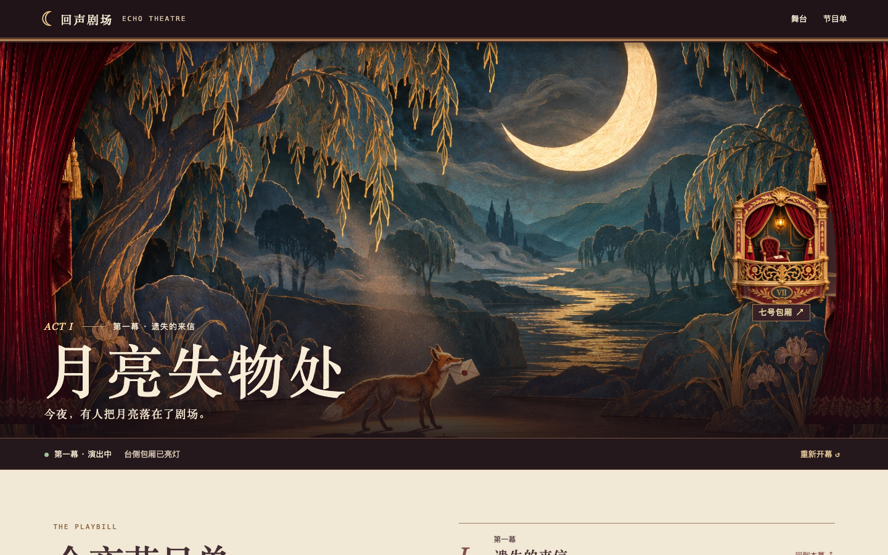

# Frontend Design Codex

为 Codex 编写的网页设计 skill，覆盖首屏选稿、场景交互、响应式排版和浏览器验收。仓库包含一个可以亲手试演的案例《月亮失物处》。

[在线进入剧场](https://wbdolf.github.io/frontend-design-codex/) · [比较三版首屏](https://wbdolf.github.io/frontend-design-codex/editions.html) · [阅读 SKILL.md](skills/frontend-design-codex/SKILL.md)

[](https://wbdolf.github.io/frontend-design-codex/)

## 试演《月亮失物处》

向下拉动金色幕绳，观察吊轨先行、布身跟随、下摆收拢。短拉后松手会合幕，也可以点击或用键盘开幕。点亮灯的七号包厢，镜头会移向台侧楼座。离席后回到进入前的那一幕。节目单可切换两幕，包厢里的信随之改变。

[桌面往返录像](https://wbdolf.github.io/frontend-design-codex/captures/loge-passage-desktop.mp4) · [手机触屏模拟录像](https://wbdolf.github.io/frontend-design-codex/captures/loge-passage-mobile.mp4)

## 使用 skill

将完整的 [frontend-design-codex 目录](skills/frontend-design-codex/) 复制到目标项目的 `.agents/skills/` 下，使入口位于 `.agents/skills/frontend-design-codex/SKILL.md`。在该项目的 Codex 会话中可这样开始：

> 用 $frontend-design-codex 为互动展览做三版首屏。使用同一套文案和素材，分别展示桌面和手机效果。我选定方向后，再继续制作完整页面。

已有明确参考时可以直接实施。局部修复可指定出错的视口、操作和预期结果。案例复盘见 [互动页面](skills/frontend-design-codex/references/case-review.md) 与 [港区工作台](skills/frontend-design-codex/references/port-operations.md)。

## 本地运行

克隆仓库后执行以下命令，在浏览器打开终端显示的本地地址。

```sh
python3 -m http.server 8000 --bind 127.0.0.1 --directory docs
```

剧场使用原生 HTML、CSS、JavaScript 和本地 WebP 舞美素材。主舞台入口是 [docs/index.html](docs/index.html)。

## 来源

Skill 目录保留了原有的 [Apache 2.0 许可证](skills/frontend-design-codex/LICENSE) 和 [来源声明](skills/frontend-design-codex/NOTICE)。剧场舞美为该演示生成。
